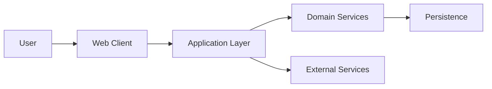

[Português](README.md) | English

# SharePay

A web application for tracking, splitting, and closing shared expenses inside wallets.

> Public technical showcase repository. The production source code is kept private.

## Main Image

> Placeholder: insert the best public screenshot here after manually reviewing the images in `assets/screenshots/`.
>
> Existing screenshots were converted to WebP and inventoried, but some appear to contain e-mails, test names, or financial values. For that reason, no image is embedded directly in this README before human review.

## Demo

**Production system:** [Open demo](https://sharepay.vnuv.net)

**Status:** functional MVP in use.

Public images and demos should use fictitious or explicitly authorized data. This repository does not document administrative routes, internal endpoints, or real infrastructure configuration.

## About The Project

SharePay is a web application for groups that need to record expenses, split costs, track pending items, and close financial periods clearly.

The system was designed for casual users such as friends, couples, shared houses, and travelers, as well as organized groups such as collectives, associations, and teams that need history, accountability, and responsible financial control.

## Key Features

- Shared wallet creation and management.
- Members and invite links.
- Personal, shared, and directed expense entries.
- Installment and recurring fixed entries.
- Pending directed entries with accept and reject flows.
- Wallet balance with participant-level totals.
- Period closing and reopening.
- Statement per closing version.
- Personal income module.
- Treasurer module for direct settlements between members.
- Wallet settings, members, and notifications.
- Freemium billing with free and paid plans.
- Account flows with login, password recovery, e-mail confirmation, and MFA.
- In-app and e-mail notifications.

## Technologies

- Frontend: Next.js, React, TypeScript, CSS Modules.
- Backend: Next.js App Router, TypeScript, Prisma, Zod.
- Database: PostgreSQL.
- Infrastructure: containerized deployment on private or managed infrastructure.
- Security: HTTP-only cookie session, secure credential hashing, TOTP MFA, e-mail confirmation, rate limiting, security headers, input validation and audit logs.
- Development: ESLint, Vitest, Playwright and TypeScript.

## Architecture

> This diagram represents only the high-level logical architecture. Implementation and infrastructure details have intentionally been omitted.

## Source Code

This repository contains only public presentation materials, high-level documentation, images, and illustrative examples.

The production source code, internal business rules, infrastructure configuration, and security mechanisms are kept in a private repository.

## Contact

- GitHub: `[GITHUB LINK]`
- LinkedIn: `[LINKEDIN LINK]`
- Personal website: `[PERSONAL WEBSITE LINK]`
- Professional e-mail: `[PROFESSIONAL EMAIL]`
