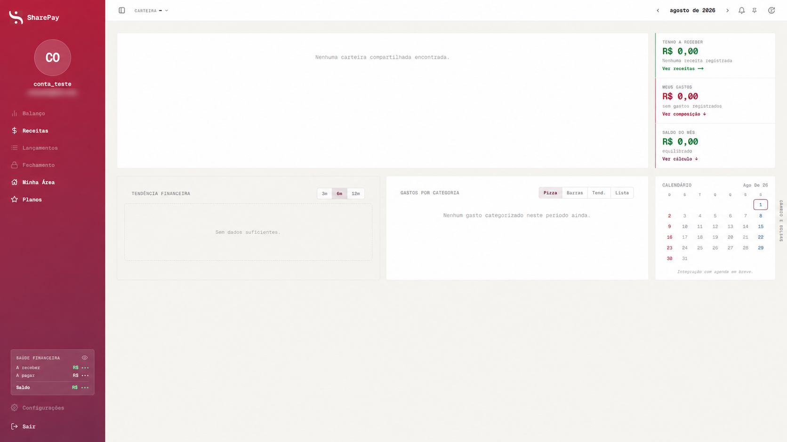
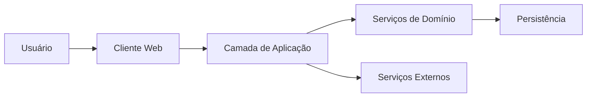
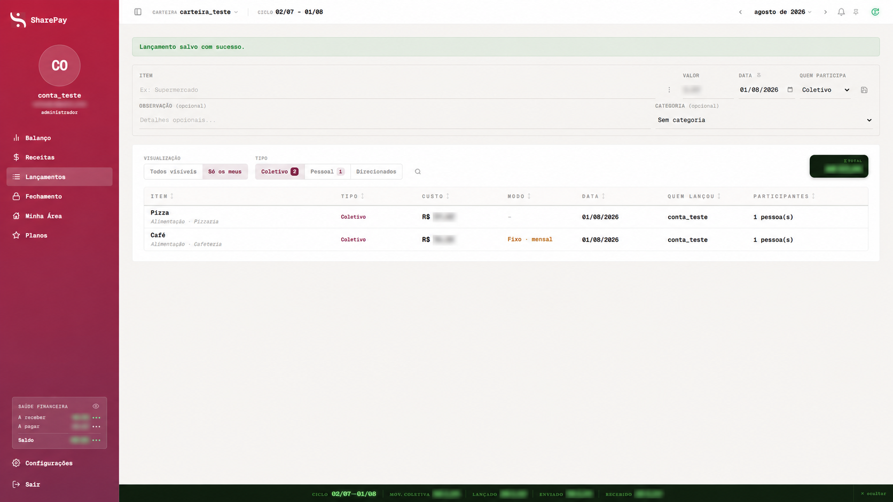

Português | [English](README.en.md)

# SharePay

Aplicação web para controle, rateio e fechamento de despesas compartilhadas em carteiras.

> Repositório público de apresentação técnica. O código-fonte de produção é mantido de forma privada.

## Imagem principal

Captura de demonstração com informações pessoais anonimizadas.

## Demonstração

**Sistema em produção:** [sharepay.vnuv.net](https://sharepay.vnuv.net)

**Status:** MVP funcional em uso.

As imagens e demonstrações públicas devem utilizar dados fictícios ou previamente autorizados. Este repositório não documenta rotas administrativas, endpoints internos ou configurações reais de infraestrutura.

## Sobre o projeto

SharePay é uma aplicação web para grupos que precisam registrar despesas, dividir custos, acompanhar pendências e fechar períodos financeiros com clareza.

O sistema foi pensado para usuários casuais, como amigos, casais, repúblicas e viajantes, e para grupos organizados, como coletivos, associações e times que precisam de histórico, prestação de contas e controle por responsável.

O problema central é substituir planilhas, conversas dispersas e controles manuais por uma visão compartilhada de carteiras, lançamentos, receitas, saldos e acertos.

## Principais funcionalidades

- Criação e gestão de carteiras compartilhadas.
- Cadastro de membros e convites por link.
- Lançamentos pessoais, coletivos e direcionados.
- Suporte a lançamentos parcelados e fixos recorrentes.
- Pendências com aceite e recusa de lançamentos direcionados.
- Balanço por carteira com saldos por participante.
- Fechamento e reabertura de períodos.
- Extrato por versão de fechamento.
- Receitas pessoais.
- Módulo de tesoureiro para acertos diretos entre membros.
- Configurações de carteira, integrantes e notificações.
- Billing freemium com plano gratuito e plano pago.
- Conta com login, recuperação de senha, confirmação por e-mail e MFA.
- Notificações no aplicativo e por e-mail.

> Prints relacionados estão mapeados em `docs/features.md` e `assets/screenshots/README.md`, mas devem ser usados somente após revisão manual.

## Tecnologias utilizadas

### Frontend

- Next.js.
- React.
- TypeScript.
- CSS Modules.

### Backend

- Next.js App Router.
- TypeScript.
- Prisma como camada de acesso a dados.
- Validação de dados com Zod.

### Banco de dados

- PostgreSQL.

### Infraestrutura

- Deploy em ambiente containerizado.
- Hospedagem e banco em infraestrutura privada ou gerenciada.

### Autenticação e segurança

- Sessão por cookie HTTP-only.
- Hash seguro de credenciais.
- MFA por TOTP.
- Confirmação de conta e novo dispositivo por e-mail.
- Rate limiting em fluxos críticos.
- Headers de segurança.
- Validação de entrada em operações de mutação.
- Audit log para operações sensíveis.

### Ferramentas de desenvolvimento

- ESLint.
- Vitest.
- Playwright.
- TypeScript.

## Arquitetura

> O diagrama representa somente a arquitetura lógica de alto nível. Detalhes de implementação e infraestrutura foram intencionalmente omitidos.

## Decisões técnicas

- Separação entre interface, aplicação, domínio e persistência.
- Uso de TypeScript para contratos mais previsíveis.
- Persistência relacional para dados financeiros estruturados.
- Validação explícita de entradas.
- Fluxos de fechamento versionados em alto nível.
- Estados claros para pendências, aceites, recusas e períodos fechados.
- Segurança em camadas para conta, sessão e operações sensíveis.
- Interface mobile-first para lançamentos rápidos.
- Uso de testes automatizados para regras financeiras e fluxos críticos.

## Desafios resolvidos

### Rateio de despesas compartilhadas

**Problema:** grupos precisam dividir gastos sem perder clareza sobre quem pagou, quem participou e quem ainda deve.

**Abordagem:** modelar lançamentos por carteira, participantes, tipo de despesa e ciclo de fechamento.

**Resultado:** o grupo acompanha valores e pendências com mais transparência, sem depender de controle manual disperso.

### Fechamento financeiro por período

**Problema:** alterar lançamentos após fechamento pode comprometer a confiança no histórico.

**Abordagem:** tratar fechamento como um marco do ciclo financeiro e manter uma visão de extrato por versão.

**Resultado:** o processo de prestação de contas fica mais claro e auditável em alto nível.

### Uso rápido em contexto mobile

**Problema:** despesas costumam ser lançadas no momento do pagamento, com pouco tempo para preencher formulários longos.

**Abordagem:** priorizar fluxos diretos, hierarquia visual clara e navegação por carteira.

**Resultado:** o registro de despesas fica mais acessível durante o uso cotidiano.

## Segurança e privacidade

Este repositório não contém segredos, credenciais, código-fonte de produção, regras internas de negócio, migrations, dumps, logs ou configurações reais de infraestrutura.

Os princípios públicos do projeto incluem credenciais fora do código, validação de entradas, controle de acesso por usuário e carteira, princípio do menor privilégio e cuidado com dados financeiros e pessoais.

## Galeria

As capturas abaixo usam dados anonimizados. As imagens originais de trabalho permanecem fora do repositório público.

### Lançamentos e acompanhamento

## Meu papel no projeto

Papel informado: **criador e desenvolvedor full stack**.

Minha participação pública neste projeto inclui idealização do produto, desenho dos fluxos financeiros, desenvolvimento da interface, implementação da camada de aplicação, modelagem conceitual dos dados, decisões de arquitetura, integrações externas, práticas de segurança, testes e manutenção evolutiva.

## Estado atual e roadmap

### Funcional

- Carteiras, membros e ciclos de fechamento.
- Lançamentos pessoais, coletivos, direcionados, parcelados e fixos.
- Pendências, balanço e acertos.
- Receitas pessoais.
- Conta, autenticação e MFA.
- Billing freemium.
- Notificações.

### Em desenvolvimento

- `[DESCREVER ITENS EM ANDAMENTO]`

### Próximos passos públicos

- Revisar screenshots com dados fictícios.
- Completar informações públicas de contato.
- `[ADICIONAR PROXIMOS PASSOS PUBLICOS]`

### Limitações conhecidas que podem ser mencionadas

- `[DESCREVER LIMITAÇÕES PÚBLICAS, SEM EXPOR VULNERABILIDADES OU DÉBITOS CRÍTICOS]`

## Código-fonte

Este repositório contém somente materiais públicos de apresentação, documentação de alto nível, imagens e exemplos ilustrativos.

O código-fonte de produção, as regras internas de negócio, as configurações de infraestrutura e os mecanismos de segurança são mantidos em um repositório privado.

## Contato

- GitHub: `[LINK DO GITHUB]`
- LinkedIn: `[LINK DO LINKEDIN]`
- Site pessoal: `[LINK DO SITE PESSOAL]`
- E-mail profissional: `[EMAIL PROFISSIONAL]`
