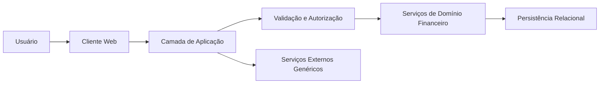

# Architecture Overview

> Este diagrama mostra apenas a arquitetura lógica de alto nível. Nomes internos, endpoints, rotas administrativas, IPs, portas, topologia de rede, bancos, buckets e configurações reais foram omitidos intencionalmente.
