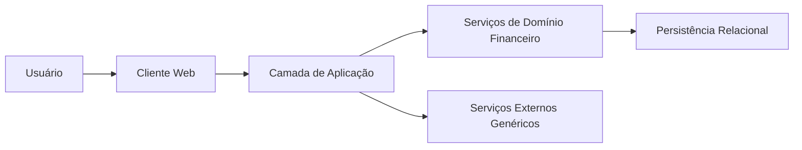

# Architecture

Este documento descreve somente a arquitetura lógica de alto nível do SharePay.

> O diagrama representa somente a arquitetura lógica de alto nível. Detalhes de implementação e infraestrutura foram intencionalmente omitidos.

## Principais camadas

- Cliente web: navegação, formulários e visualização de carteiras, lançamentos, balanços, fechamento e configurações.
- Camada de aplicação: coordena ações do usuário, valida entradas e encaminha operações.
- Serviços de domínio financeiro: organizam regras gerais de lançamentos, ciclos, pendências, receitas, balanço e fechamento.
- Persistência: armazena dados estruturados em banco relacional.
- Serviços externos: integrações genéricas para e-mail, cobrança, armazenamento ou outros serviços auxiliares quando aplicável.

## Omitido intencionalmente

- Modelo completo de banco de dados.
- Endpoints reais.
- Regras internas de autenticação e autorização.
- Rotas administrativas.
- Configurações de deploy.
- IPs, portas, containers, buckets, bancos ou identificadores de infraestrutura.
